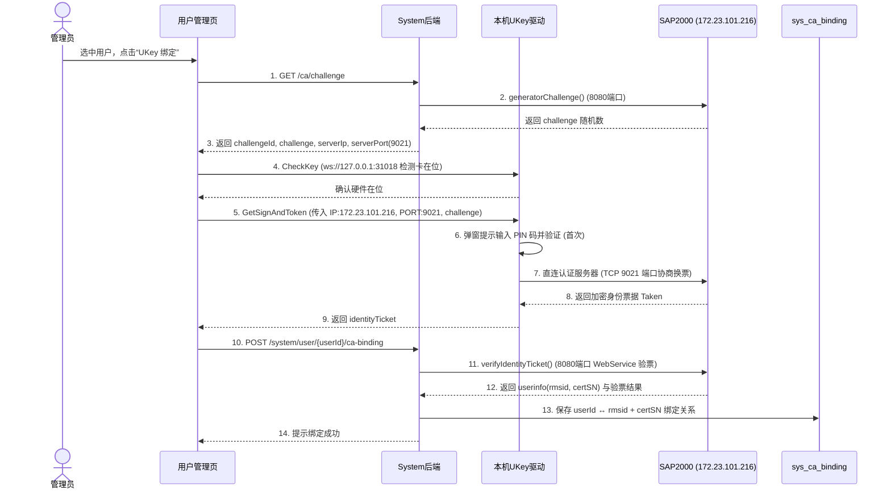
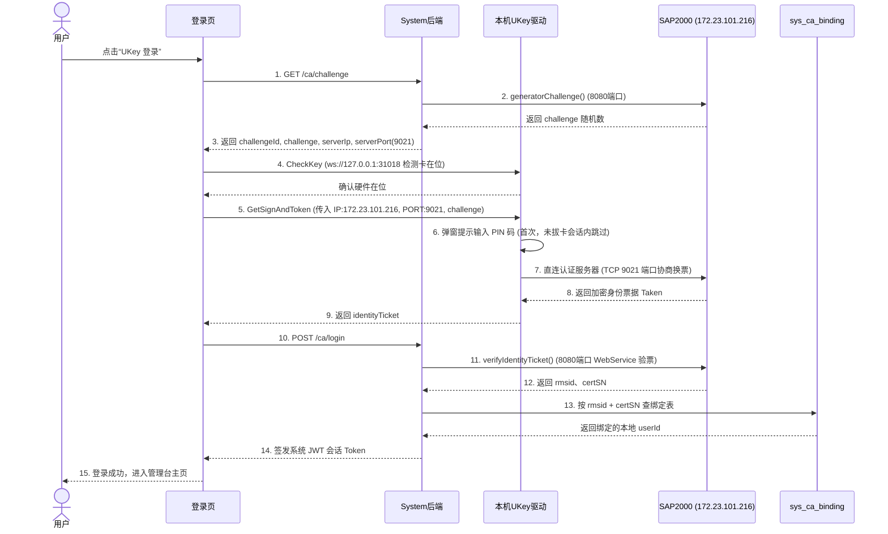

# SAP2000 UKey 统一身份认证对接说明

登录页支持“UKey 登录”，用户管理“更多”操作支持“UKey 绑定”。
系统采用“管理员后台一对一绑定 + 物理硬件免密登录”的标准政务集成模式。随机数挑战值在 Redis 中保存 120 秒，同一挑战值只允许提交验票一次。

---

## 1. 核心架构与网络策略要求

SAP2000 采用**双通道认证**架构，涉及服务器端与客户端两个完全独立的网络链路：

```
【用户办公电脑】
  ├── 浏览器 ──(ws://127.0.0.1:31018)──> 本地 UKey 驱动 (IBSapTrusAH)
  └── 本地 UKey 驱动 ──(TCP: 9021端口 直连)──────────────────────────────┐
                                                                       │
【应用服务器 (ssft-sjdglj-0001)】                                      ▼
  └── 系统后端 Java ──(HTTP: 8080端口 WebService)──> 【SAP2000 认证中心 (172.23.101.216)】
```

### 必需开通的网络策略：
1. **服务器端通道（8080 端口）**：
   - **通信路径**：后端服务器（`172.24.160.43`） ➔ SAP2000 认证中心（`172.23.101.216:8080`）
   - **协议与方法**：HTTP / SOAP WebService
   - **作用**：获取随机数挑战值（`generatorChallenge`）及服务端验票（`verifyIdentityTicket`）。
2. **客户端电脑通道（9021 端口）**：
   - **通信路径**：用户办公电脑 ➔ SAP2000 认证中心（`172.23.101.216:9021`）
   - **协议与方法**：TCP 直连
   - **作用**：客户端驱动在用户输入 PIN 码后，直连认证服务器换取加密票据（`GetSignAndToken`）。
3. **客户端本机驱动通道（31018 端口）**：
   - **通信路径**：浏览器 ➔ 本机（`ws://127.0.0.1:31018`）
   - **作用**：浏览器与本地已安装的 UKey 驱动服务进行 WebSocket 通信。

---

## 2. 完整调用时序

### 2.1 UKey 绑定时序（管理员在用户管理后台操作）



### 2.2 UKey 登录时序（普通用户登录）



---

## 3. 生产环境配置（`application.yml`）

生产配置文件位于服务器 `/var/app/config/application.yml`：

```yaml
ca:
  mock-enabled: false                                                # 生产关闭模拟模式
  app-server-id: 'ff808081a08e2da801a0ccdf520f0009'                  # RMS 分配的应用服务 ID
  server-ip: '172.23.101.216'                                        # 客户端驱动直连的认证服务 IP
  server-port: 9021                                                  # 客户端驱动直连的票据端口
  wsdl-url: 'http://172.23.101.216:8080/services/authWS?wsdl'        # 后端 WebService 验票/随机数地址
  success-results: 0,success,true                                    # 验票返回成功的判定值
```

---

## 4. 数据库要求

首次部署前必须先在生产数据库执行绑定表脚本（只创建 `sys_ca_binding` 表）：
- **人大金仓 Kingbase 版**：[`Sql/ca_ukey_binding_kingbase.sql`](../Sql/ca_ukey_binding_kingbase.sql)
- **MySQL 版**：[`Sql/ca_ukey_binding.sql`](../Sql/ca_ukey_binding.sql)

---

## 5. 客户端电脑使用前准备

1. **安装驱动**：
   在插 UKey 的 Windows 办公电脑上，运行驱动安装程序：
   `身份认证（sap2000)开发对接new(1)/驱动/IBSapTrusAH_210819.exe`。
2. **确认驱动运行**：
   安装完成后右下角任务栏托盘会有驱动图标，本地后台监听 `ws://127.0.0.1:31018`。
3. **开通网络策略**：
   确保该办公电脑能够通过 TCP 访问认证服务器的 **`172.23.101.216:9021`**。
   验证命令（Windows CMD）：
   ```cmd
   telnet 172.23.101.216 9021
   ```
4. **插入 UKey**：
   将硬件插入 USB 口，确认驱动管理工具能正常读取卡片信息后，即可在管理台发起绑定或登录。
